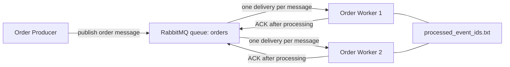

# Module 5 Assignment: Asynchronous Messaging

An order producer publishes messages to a RabbitMQ queue. Two order workers consume that same queue as competing consumers. Each message is acknowledged only after the worker finishes it. Workers remember `event_id` values so a second delivery does not repeat the business action.

## Run RabbitMQ, the producer, and the workers

Python 3.9 or newer is required. RabbitMQ runs in Docker.

```bash
docker compose up -d
docker inspect -f '{{.State.Health.Status}}' module5-rabbitmq
```

Wait until the health check prints `healthy`. The broker listens on `127.0.0.1:5672`. The management UI is at `http://127.0.0.1:15672` (`guest` / `guest`).

```bash
python3 -m venv .venv
source .venv/bin/activate
pip install -r requirements.txt
```

Start two workers in separate terminals. They are independent processes on the same `orders` queue.

```bash
python worker.py --name worker-1
```

```bash
python worker.py --name worker-2
```

Publish four orders from a third terminal:

```bash
python producer.py
```

Each message contains `event_id`, `order_id`, `item_id`, and `quantity`. The producer waits for RabbitMQ to confirm the publish. Messages are persistent and the queue is durable. Workers use manual acknowledgements and `prefetch_count=1`, so a worker holds only one unacked message at a time.

Stop the stack with `Ctrl+C` in the worker terminals and `docker compose down`.

## Architecture



The producer and the workers do not call each other. RabbitMQ sits between them. Both workers consume `orders`, and the broker gives each message to only one of them. After a worker applies the business action, it writes the `event_id` to `data/processed_event_ids.txt` and appends a line to `data/business_actions.log`. Those files are shared by every worker process. An ACK is sent only after that work is recorded. A duplicate `event_id` is acknowledged and skipped.

## Example of successful message processing

`python producer.py` published:

```text
[producer] published event_id=evt-1001 order_id=ord-1001 item_id=laptop quantity=1
[producer] published event_id=evt-1002 order_id=ord-1002 item_id=keyboard quantity=2
[producer] published event_id=evt-1003 order_id=ord-1003 item_id=headphones quantity=1
[producer] published event_id=evt-1004 order_id=ord-1004 item_id=mouse quantity=3
[producer] 4 message(s) confirmed on queue orders
```

Worker 1 logged the orders it finished, then acknowledged them:

```text
[worker-1] listening on queue orders
[worker-1] received event_id=evt-1001 order_id=ord-1001 item_id=laptop quantity=1 redelivered=False
[worker-1] processing order_id=ord-1001 item_id=laptop quantity=1
[worker-1] ack event_id=evt-1001
[worker-1] received event_id=evt-1003 order_id=ord-1003 item_id=headphones quantity=1 redelivered=False
[worker-1] processing order_id=ord-1003 item_id=headphones quantity=1
[worker-1] ack event_id=evt-1003
```

## Evidence of two competing consumers

Worker 2 was connected to the same queue at the same time. It received the other two messages. No `event_id` appears in both logs.

```text
[worker-2] listening on queue orders
[worker-2] received event_id=evt-1002 order_id=ord-1002 item_id=keyboard quantity=2 redelivered=False
[worker-2] processing order_id=ord-1002 item_id=keyboard quantity=2
[worker-2] ack event_id=evt-1002
[worker-2] received event_id=evt-1004 order_id=ord-1004 item_id=mouse quantity=3 redelivered=False
[worker-2] processing order_id=ord-1004 item_id=mouse quantity=3
[worker-2] ack event_id=evt-1004
```

The business log shows the same split. Each order was handled by one worker:

```text
worker-1 processed event_id=evt-1001 order_id=ord-1001 item_id=laptop quantity=1
worker-2 processed event_id=evt-1002 order_id=ord-1002 item_id=keyboard quantity=2
worker-1 processed event_id=evt-1003 order_id=ord-1003 item_id=headphones quantity=1
worker-2 processed event_id=evt-1004 order_id=ord-1004 item_id=mouse quantity=3
```

After those acknowledgements the queue was empty and both consumers were still connected:

```text
name    messages  messages_ready  messages_unacknowledged  consumers
orders  0         0               0                        2
```

## Evidence of failure and redelivery

This run stops worker 1 after it receives a message and before it sends an ACK.

```bash
CRASH_BEFORE_ACK_EVENT_ID=evt-2001 python worker.py --name worker-1
```

```bash
python producer.py --event-id evt-2001 --order-id ord-2001 --item-id laptop --quantity 1
```

Worker 1 received the first delivery and exited without acknowledging it:

```text
[worker-1] listening on queue orders
[worker-1] will exit before ACK if event_id=evt-2001 arrives
[worker-1] received event_id=evt-2001 order_id=ord-2001 item_id=laptop quantity=1 redelivered=False
[worker-1] stopping before ACK for event_id=evt-2001; business action not applied; message stays unacknowledged
```

That process was gone. The business log had no `evt-2001` line yet. RabbitMQ put the message back on the queue. `messages_ready` was 1 and `messages_unacknowledged` was 0 because the dead worker never acked:

```text
name    messages  messages_ready  messages_unacknowledged  consumers
orders  1         1               0                        0
```

The broker was still running. Starting the other worker delivered the same message again, with `redelivered=True`:

```bash
python worker.py --name worker-2
```

```text
[worker-2] listening on queue orders
[worker-2] received event_id=evt-2001 order_id=ord-2001 item_id=laptop quantity=1 redelivered=True
[worker-2] processing order_id=ord-2001 item_id=laptop quantity=1
[worker-2] ack event_id=evt-2001
```

Worker 2 stayed up, and the RabbitMQ container stayed `running` and `healthy`. The queue was empty again with that worker still connected:

```text
name    messages  messages_ready  messages_unacknowledged  consumers
orders  0         0               0                        1
```

## Evidence of duplicate handling

`evt-1001` was already processed in the first run, so its id is in `data/processed_event_ids.txt`. Publishing that same event again does not repeat the business action:

```bash
python producer.py --event-id evt-1001 --order-id ord-1001 --item-id laptop --quantity 1
```

```text
[worker-2] received event_id=evt-1001 order_id=ord-1001 item_id=laptop quantity=1 redelivered=False
[worker-2] duplicate event_id=evt-1001 detected; business action skipped
[worker-2] ack event_id=evt-1001
```

The worker still acknowledges the duplicate so it leaves the queue. `data/business_actions.log` contains `event_id=evt-1001` once:

```text
worker-1 processed event_id=evt-1001 order_id=ord-1001 item_id=laptop quantity=1
worker-2 processed event_id=evt-1002 order_id=ord-1002 item_id=keyboard quantity=2
worker-1 processed event_id=evt-1003 order_id=ord-1003 item_id=headphones quantity=1
worker-2 processed event_id=evt-1004 order_id=ord-1004 item_id=mouse quantity=3
worker-2 processed event_id=evt-2001 order_id=ord-2001 item_id=laptop quantity=1
```

The recorded ids after these runs:

```text
evt-1001
evt-1002
evt-1003
evt-1004
evt-2001
```

The file is shared on purpose. An in-memory set inside one process would disappear when that process exits and would be invisible to the other worker.

## Reflection

A message can arrive more than once because RabbitMQ removes it only after an acknowledgement. In the failure test, worker 1 received `evt-2001` and exited before the ACK, so the broker still considered that message unfinished and delivered it to worker 2 with `redelivered=True`. The same thing happens if the network drops after the work is done but before the ACK reaches the broker, and a publisher retry can also put a second copy on the queue. Idempotent handling stores the `event_id` when the business action is applied, and a later delivery of that id is only logged and acknowledged. The duplicate leaves the queue, and the order is not processed a second time.
